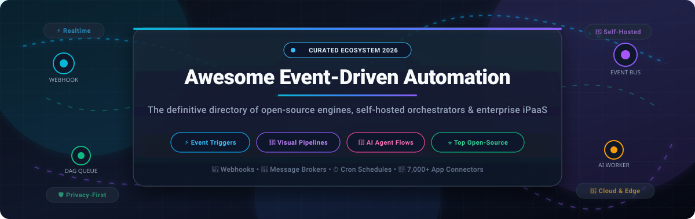

  

  
  
  
  
  
  
  

<h1 align="center">⚡ Awesome Event-Driven Automation</h1>

  <strong>The definitive curated index of top SaaS iPaaS platforms, open-source workflow orchestrators, event brokers, and self-hosted automation engines.</strong>

  <em>Discover, compare, and benchmark tools that listen to webhooks, message queues, IoT signals, schedules, and APIs to execute autonomous workflows without full custom backend maintenance.</em>

---

## 📑 Table of Contents

- [🎯 Overview & Core Concepts](#-overview--core-concepts)
- [🌐 Sector Overview & Market Dynamics](#-sector-overview--market-dynamics)
- [☁️ Top SaaS & Hosted Automation Platforms](#️-top-saas--hosted-automation-platforms)
- [💻 Open-Source & Self-Hosted Automation Engines](#-open-source--self-hosted-automation-engines)
  - [⭐ Ranked by GitHub_Stars](#-ranked-by-github-stars)
  - [🔍 Detailed Project Breakdown](#-detailed-project-breakdown)
- [🧠 Architectural Selection Matrix](#-architectural-selection-matrix)
- [🤝 How to Contribute](#-how-to-contribute)
- [💖 Support & Community](#-support--community)
- [⭐ Star History](#--star-history)
- [⚖️ License & Disclaimer](#️-license--disclaimer)

---

## 🎯 Overview & Core Concepts

**Event-Driven Automation (EDA)** refers to systems where software workflows are executed asynchronously in direct reaction to state-change events—such as an incoming HTTP webhook, Kafka/RabbitMQ message, database write, cron schedule, IoT sensor payload, or third-party SaaS trigger.

Instead of writing and maintaining brittle glue scripts or heavy backend services, event-driven automation frameworks provide:
- ⚡ **Real-Time Trigger Handling**: Instant ingestion of webhook notifications and distributed event buses.
- 🔀 **Visual & Code-Based DAG Pipelines**: Flexible branching logic, looping iterators, deduplication, and error handlers.
- 🔌 **Pre-Built Connectors**: Turnkey integrations into hundreds of SaaS APIs, cloud datastores, and notification channels.
- 🤖 **AI-Agent Augmentation**: Native integration with Large Language Models (LLMs), semantic vector search, and tool execution.
- 🛡️ **Self-Hosted Privacy**: Full on-premise data control to prevent leaking sensitive corporate tokens and customer records.

---

## 🌐 Sector Overview & Market Dynamics

The global **Integration Platform as a Service (iPaaS)** and automated workflow orchestration market was valued at **$11.8 billion in 2024** and is projected to surge past **$38.5 billion to $45.2 billion by 2030**, expanding at a robust compound annual growth rate (**CAGR of ~21.5% to 24.8%**). Catalysts include the exponential sprawl of enterprise cloud apps, escalating demands for real-time customer data sync, and the surge in AI-agent workflow delegation.

The market displays **moderate-to-high fragmentation** rather than a winner-take-all monopoly:
- **Ecosystem Bundlers**: Hyperscalers like Microsoft (Power Automate) leverage massive enterprise licensing and M365 ecosystems to capture standard corporate productivity automation.
- **Consumer & SMB No-Code Category Leaders**: Established pioneers like Zapier and Make command strong brand affinity among non-technical operators and growth marketers.
- **High Fragmentation Niches**: Total monopolization is actively prevented by deep technological divergences across four distinct developer paradigms:
  1. *Developer-First Programmable iPaaS* (Pipedream, Windmill, Trigger.dev) with native Git sync, TypeScript/Python runtimes, and local testing.
  2. *Hardware & IoT Event-Wiring* (Node-RED) dominating edge gateways, MQTT sensors, and smart buildings.
  3. *Mission-Critical Data Pipeline DAGs* (Airflow, Prefect, Dagster, Kestra) orchestrating multi-terabyte data warehouses.
  4. *Privacy-First Self-Hosted Engines* (n8n, Activepieces) adopted heavily in healthcare, finance, and European enterprises requiring strict GDPR and data sovereignty guarantees without per-task SaaS tax.

---

## ☁️ Top SaaS & Hosted Automation Platforms

The following table compares leading commercial SaaS and hosted event-driven automation platforms. The entries are **sorted in descending order by Company Size (Enterprise Valuation / ARR)**.

| 🏢 Platform | 💰 Company Scale (Valuation / ARR) | 🏷️ Starting Paid Tier | 🎁 Free Tier Limits (Forever or Trial) | 💡 Key Strengths & Target Use Case |
| :--- | :--- | :--- | :--- | :--- |
| **[Microsoft Power Automate](https://powerautomate.microsoft.com/)** | **~$3.1+ Trillion Market Cap** *(MSFT; Power Platform ARR &gt; $2.5B)* | **$15.00/user/mo** *(Power Automate Premium)* or **$150.00/bot/mo** *(Process)* | **Free with M365** *(Standard connectors only, 6,000 API requests/day; no desktop RPA or premium third-party connectors; 90-day free trial for Premium)* | Native integration with Office 365, Dynamics, Azure, and enterprise Windows desktop RPA. |
| **[Make](https://www.make.com/)** *(formerly Integromat)* | **~$13.0 Billion Valuation** *(Parent: Celonis; Make ARR ~$50M+)* | **$9.00/mo** *(Core plan, billed annually at $108/yr)* or **$10.59/mo** *(monthly)* | **Free forever**: 1,000 operations/month, 2 active scenarios, 15-minute minimum execution interval, 512 MB data transfer limit | Highly visual 2D scenario builder with complex visual data mapping, routers, iterators, and aggregators. |
| **[Automate.io](https://automate.io/)** *(Acquired by Notion)* | **~$10.0 Billion Valuation** *(Parent: Notion; acquired & integrated)* | **$10.00/user/mo** *(Included inside Notion Plus plan)* | **Free forever with Notion**: Up to 2 automated workflows per database, capped at 100 webhook/automation executions per month | Built directly into Notion databases and team workspaces to trigger notifications and sync CRM items. |
| **[Zapier](https://zapier.com/)** | **~$5.0 Billion Valuation** *(~$310M ARR, profitable)* | **$19.99/mo** *(Professional, billed annually at $239.88/yr)* or **$29.99/mo** *(monthly)* | **Free forever**: 100 tasks/month, unlimited two-step Zaps (1 trigger + 1 action only), 15-minute polling interval | The undisputed integration catalog king with 7,000+ connected SaaS applications and zero-code setup. |
| **[Tray.io](https://tray.io/)** *(Tray.ai)* | **~$600 Million Valuation** *(~$70M ARR, $150M+ funding raised)* | **$595.00/mo** *(Pro Tier, custom annual enterprise quote)* | **14-day free trial** upon enterprise request *(Includes up to 5,000 test workflow tasks and access to standard integrations)* | Enterprise-grade iPaaS offering elastic multi-tenant serverless execution, governance, SSO, and Merlin AI. |
| **[IFTTT](https://ifttt.com/)** | **~$200 Million Valuation** *(~$3.5M ARR, $62.5M venture funding)* | **$2.99/mo** *(Pro plan, billed annually at $35.88/yr)* or **$3.99/mo** *(monthly)* | **Free forever**: 2 active Applets (single-action: 1 trigger + 1 action), standard polling interval up to 60 minutes | Consumer smart home automation, social media auto-posting, and mobile device hooks (iOS/Android). |
| **[Pipedream](https://pipedream.com/)** | **~$100 Million Valuation** *(Subsidiary of Workday; $20M Series A, ~$10M ARR)* | **$29.00/mo** *(Basic plan, billed annually at $348/yr)* or **$39.00/mo** *(monthly)* | **Free forever**: 100 credits/day (~3,000 credits/mo; 1 credit = 30s compute time), 3 active workflows, 750s daily test builder runtime | Developer-first serverless execution supporting custom Node.js, Python, Go, and Bash steps with built-in auth. |
| **[Albato](https://albato.com/)** | **~$25 Million Est. Valuation** *(~$3.0M ARR, $1M+ seed funding)* | **$15.00/mo** *(Pro plan, billed annually at $180/yr)* or **$22.00/mo** *(monthly)* | **Free forever**: 100 transactions/month, 5 active automations, 2 steps per automation, 15-minute update interval | Budget-friendly no-code automations with an embedded white-label iPaaS edition for B2B SaaS applications. |
| **[Integrately](https://integrately.com/)** | **~$15 Million Est. Valuation** *(Parent: CompanyHub, bootstrapped, ~$4.5M ARR)* | **$19.99/mo** *(Starter plan, billed annually at $239.88/yr)* or **$29.99/mo** *(monthly)* | **Free forever**: 100 tasks/month, 5 active automations, single-step workflows, 15-minute polling interval | Turnkey "1-click" pre-built automation recipes geared towards non-technical marketing and sales teams. |
| **[Pabbly Connect](https://www.pabbly.com/connect/)** | **~$12 Million Est. Valuation** *(Parent: Magnet Brains, bootstrapped, ~$3.1M ARR)* | **$16.00/mo** *(Standard, billed annually at $192/yr)* or **$249.00 one-time** *(Lifetime Deal)* | **Free forever**: 100 tasks/month, unlimited workflows, free internal tasks (routers, filters, formatters, and math tools) | Ultra-economical alternative with non-depleting internal tasks and lifetime license options. |

---

## 💻 Open-Source & Self-Hosted Automation Engines

Open-source and self-hosted automation platforms give engineering teams total control over their data pipelines, eliminate restrictive per-task pricing, and allow direct hosting on Kubernetes, Docker, or bare metal.

### ⭐ Ranked by GitHub_Stars

The list below is strictly **sorted in descending order by GitHub_Stars**:

| # | 📦 Repository & Name | ⭐ GitHub Stars_Count Badge | 📜 License | 🛠️ Primary Tech Stack | 🎯 Best For |
| :-: | :--- | :--- | :--- | :--- | :--- |
| **1** | **[n8n](https://github.com/n8n-io/n8n)** |  | Fair-code (Sustainable Use) | Node.js, TypeScript, Vue | Enterprise-ready visual workflow builder & AI LangChain agents |
| **2** | **[Huginn](https://github.com/huginn/huginn)** |  | MIT | Ruby, Rails | Autonomous monitoring agents, web scraping, and event alerts |
| **3** | **[Apache Airflow](https://github.com/apache/airflow)** |  | Apache 2.0 | Python | Complex data engineering DAGs & event-driven ETL orchestration |
| **4** | **[Kestra](https://github.com/kestra-io/kestra)** |  | Apache 2.0 | Java, Micronaut, Vue | Declarative YAML-first event-driven workflow orchestration |
| **5** | **[Activepieces](https://github.com/activepieces/activepieces)** |  | MIT | TypeScript, Node.js, Angular | True MIT-licensed open-source Zapier alternative with AI tools |
| **6** | **[Prefect](https://github.com/PrefectHQ/prefect)** |  | Apache 2.0 | Python | Dynamic Pythonic event pipelines and background orchestration |
| **7** | **[Temporal](https://github.com/temporalio/temporal)** |  | MIT | Go, Java, TypeScript, Python | Fault-tolerant durable microservice orchestration & state machines |
| **8** | **[Node-RED](https://github.com/node-red/node-red)** |  | Apache 2.0 | JavaScript, Node.js | IoT sensor wiring, edge device triggers, and MQTT message buses |
| **9** | **[Windmill](https://github.com/windmill-labs/windmill)** |  | AGPLv3 / Apache 2.0 | Rust, TypeScript, Svelte, Python | Turning multi-language scripts into workflows, UIs, and endpoints |
| **10** | **[Argo Workflows](https://github.com/argoproj/argo-workflows)** |  | Apache 2.0 | Go, Kubernetes CRDs | Cloud-native containerized workflow pipelines for Kubernetes |
| **11** | **[Trigger.dev](https://github.com/triggerdotdev/trigger.dev)** |  | Apache 2.0 | TypeScript, Node.js | Full-stack TypeScript background jobs with real-time streaming |
| **12** | **[Dagster](https://github.com/dagster-io/dagster)** |  | Apache 2.0 | Python, TypeScript | Asset-oriented event-driven data orchestrator with testability |
| **13** | **[Automatisch](https://github.com/automatisch/automatisch)** |  | AGPLv3 | JavaScript, Node.js, React | GDPR-compliant self-hosted business workflow automation |
| **14** | **[Rundeck](https://github.com/rundeck/rundeck)** |  | Apache 2.0 | Java, Groovy | Ops runbook automation, scheduled node jobs, and incident response |
| **15** | **[Inngest](https://github.com/inngest/inngest)** |  | Apache 2.0 | Go, TypeScript | Serverless event-driven step functions, delays, and queues |
| **16** | **[Platypush](https://github.com/blacklight/platypush)** |  | MIT | Python | Multi-protocol IoT and home automation engine with webhooks |

---

### 🔍 Detailed Project Breakdown

#### 1. 🥇 [n8n](https://github.com/n8n-io/n8n)

- **Architecture**: Visual node-based workflow designer powered by Node.js and TypeScript.
- **Triggers**: Webhooks, polling schedules, message brokers (Kafka, RabbitMQ), IMAP email, and 500+ pre-built integration nodes.
- **AI Capabilities**: Deep LangChain integration featuring native nodes for autonomous LLM agents, vector stores (Pinecone, Qdrant), and conversational memory.
- **Licensing**: Sustainable Use License (Fair-code; free for internal business self-hosting, resale as a hosted SaaS is prohibited).
- **Deployment**: Docker Compose, Kubernetes with Helm, or single binary via npm. Scalable horizontally via Redis queue mode and PostgreSQL.

#### 2. 🥈 [Huginn](https://github.com/huginn/huginn)

- **Architecture**: Agent-based automated event watcher written in Ruby on Rails. Often described as your own private IFTTT or Yahoo! Pipes.
- **Triggers**: Web scraping (XPath/CSS selectors), RSS/Atom feeds, weather events, email monitors, and outgoing webhook calls.
- **Licensing**: MIT License.
- **Deployment**: Native Docker image with MySQL/PostgreSQL backends. Ideal for set-and-forget monitoring, web scrapers, and alerting daemons.

#### 3. 🥉 [Apache Airflow](https://github.com/apache/airflow)

- **Architecture**: Industry standard batch and event-driven data orchestrator using Directed Acyclic Graphs (DAGs) defined purely in Python code.
- **Triggers**: Airflow 2.x and 3.0 include native event-driven scheduling (deferrable operators, SQS/Kafka/PubSub triggers, datasets).
- **Licensing**: Apache 2.0 License.
- **Deployment**: Celery, KubernetesExecutor, or managed services (AWS MWAA, Google Cloud Composer).

#### 4. ⚡ [Kestra](https://github.com/kestra-io/kestra)

- **Architecture**: Modern, event-driven declarative orchestrator built on Java/Micronaut, configured entirely in declarative YAML.
- **Triggers**: Real-time webhooks, schedules, file watchers, Kafka topics, and external database state alterations.
- **Licensing**: Apache 2.0 License.
- **Deployment**: Single container, Docker Compose, or Kubernetes. Includes built-in code editor, topology charts, and 500+ plugin integrations.

#### 5. 🧩 [Activepieces](https://github.com/activepieces/activepieces)

- **Architecture**: Modern, lightweight, no-code workflow builder written entirely in TypeScript with an Angular frontend.
- **Triggers**: Webhooks, polling schedules, form submissions, and 400+ community pieces (integrations).
- **Licensing**: True permissive MIT License.
- **Deployment**: Docker Compose with Redis and PostgreSQL. Developer-friendly SDK allows building new custom integration "pieces" in under 15 minutes.

#### 6. 🐍 [Prefect](https://github.com/PrefectHQ/prefect)

- **Architecture**: Modern Pythonic workflow orchestration engine transforming arbitrary Python functions into durable DAGs via simple `@flow` and `@task` decorators.
- **Triggers**: Event-driven webhooks, work-pool queues, and CloudEvents.
- **Licensing**: Apache 2.0 License.
- **Deployment**: Self-hosted Prefect Server via Docker or Prefect Cloud hybrid orchestration.

#### 7. ⏱️ [Temporal](https://github.com/temporalio/temporal)

- **Architecture**: Distributed, scalable, durable execution platform. Code workflows in Go, Java, TypeScript, or Python without worrying about dropped events, server failures, or network timeouts.
- **Triggers**: Asynchronous event signals, queries, gRPC calls, and durable sleep timers.
- **Licensing**: MIT License.
- **Deployment**: Clustered deployment backed by Cassandra, PostgreSQL, or MySQL.

#### 8. 🔴 [Node-RED](https://github.com/node-red/node-red)

- **Architecture**: Browser-based flow editor developed by IBM for wiring together hardware devices, APIs, and online services.
- **Triggers**: MQTT messages, raw TCP/UDP packets, WebSockets, HTTP requests, and hardware GPIO pins.
- **Licensing**: Apache 2.0 License.
- **Deployment**: Ultra-lightweight runtime runnable on Raspberry Pi, industrial edge gateways, and Docker.

#### 9. ⚙️ [Windmill](https://github.com/windmill-labs/windmill)

- **Architecture**: High-performance developer platform written in Rust that turns scripts (Python, TypeScript, Go, Bash, SQL) into asynchronous workflows, auto-generated UIs, and scheduled jobs.
- **Triggers**: Webhooks, cron schedules, Kafka, Postgres logical replication streams.
- **Licensing**: AGPLv3 Community Edition / Apache 2.0 worker components.
- **Deployment**: Extremely fast execution footprint (sub-millisecond overhead) deployable via Docker Compose or Helm.

#### 10. ☸️ [Argo Workflows](https://github.com/argoproj/argo-workflows)

- **Architecture**: CNCF graduated container-native workflow engine implemented as a Kubernetes Custom Resource Definition (CRD).
- **Triggers**: Combined with **Argo Events** to trigger workflows from S3 events, webhooks, AMQP, and Kafka.
- **Licensing**: Apache 2.0 License.
- **Deployment**: Native Kubernetes cluster deployment.

#### 11. 🎯 [Trigger.dev](https://github.com/triggerdotdev/trigger.dev)

- **Architecture**: Code-first background jobs and event-driven workflow engine designed for modern TypeScript and Next.js applications.
- **Triggers**: Webhooks, event dispatching, schedules, and long-running job steps with zero timeouts.
- **Licensing**: Apache 2.0 License.
- **Deployment**: Docker Compose with PostgreSQL or managed cloud platform.

#### 12. 📊 [Dagster](https://github.com/dagster-io/dagster)

- **Architecture**: Cloud-native data orchestrator designed around software-defined assets and declarative event triggers.
- **Triggers**: Asset sensors, schedules, and external event streams.
- **Licensing**: Apache 2.0 License.
- **Deployment**: Docker, Helm chart on Kubernetes, or Dagster Cloud.

#### 13. 🤖 [Automatisch](https://github.com/automatisch/automatisch)

- **Architecture**: Open-source, no-code automation engine designed as an on-premise Zapier alternative prioritizing European GDPR compliance.
- **Triggers**: App webhooks, schedules, and cloud service polling.
- **Licensing**: AGPLv3 License.
- **Deployment**: Single command Docker deployment.

#### 14. 🛠️ [Rundeck](https://github.com/rundeck/rundeck)

- **Architecture**: Runbook automation console that coordinates shell commands, scripts, and API jobs across distributed server nodes.
- **Triggers**: Webhook event notifications, monitoring system alerts (PagerDuty, Datadog), and cron schedules.
- **Licensing**: Apache 2.0 License.
- **Deployment**: WAR package or Docker container with role-based access control (RBAC).

#### 15. 📥 [Inngest](https://github.com/inngest/inngest)

- **Architecture**: Event-driven execution engine enabling serverless background functions, durable step execution, concurrency limits, and retry queues without configuring AWS SQS or Redis.
- **Triggers**: Custom JSON events dispatched from client SDKs (TypeScript, Python, Go).
- **Licensing**: Apache 2.0 License.
- **Deployment**: Self-hosted Inngest Dev Server via Docker or production Inngest Cloud.

#### 16. 💡 [Platypush](https://github.com/blacklight/platypush)

- **Architecture**: Python-native automation platform designed for IoT devices, smart homes, and custom event-reactive scripts.
- **Triggers**: Sensor readings, media events, voice commands, bluetooth beacons, and webhooks.
- **Licensing**: MIT License.
- **Deployment**: Lightweight Python package or Docker container running on Linux, Raspberry Pi, or home servers.

---

## 🧠 Architectural Selection Matrix

Choose the ideal tool based on your project's technical requirements:

| Use Case Requirements | Recommended Tools | Why? |
| :--- | :--- | :--- |
| **Non-technical teams & marketing automations** | **Zapier**, **Make**, **Activepieces** | Intuitive visual builders, zero coding required, rich third-party SaaS app libraries. |
| **Strict privacy & on-premise GDPR compliance** | **n8n**, **Activepieces**, **Automatisch** | Self-hosted inside your VPC; credentials and customer payloads never leave your infrastructure. |
| **Code-first developers (TypeScript / Python)** | **Pipedream**, **Windmill**, **Trigger.dev**, **Inngest** | Real programming languages, Git integration, npm/pip package support, sub-second execution. |
| **Long-running, mission-critical distributed state** | **Temporal** | Fault-tolerant durable execution; transactions survive power failures and process crashes. |
| **Hardware, edge gateways & IoT sensors** | **Node-RED**, **Platypush** | Native MQTT, WebSockets, GPIO pin handlers, and tiny memory footprint. |
| **Enterprise IT ops & DevOps runbooks** | **Rundeck**, **Windmill** | Server fleet management, bash/script execution, RBAC auditing, and credential vaulting. |
| **Heavy data pipelines & warehouse ETL** | **Apache Airflow**, **Prefect**, **Dagster**, **Kestra** | Dynamic DAG orchestration, Pandas/Spark support, backfills, and data quality checks. |

---

## 🤝 How to Contribute

Contributions are warmly encouraged! Help keep this directory current, accurate, and comprehensive:

1. 🍴 **Fork the repository** on GitHub.
2. 🌿 **Create a new branch**: `git checkout -b add-automation-tool`
3. 📝 **Add or update entries**:
   - For SaaS tools: include verified starting tier pricing, free tier limits, and estimated company valuation/ARR.
   - For open-source tools: include official repo link, accurate Stars_Badge (`style=social&color=white`), license type, and tech stack.
4. 🚀 **Submit a Pull Request** with a concise description of your changes.

---

## 💖 Support & Community

Thank you for exploring and utilizing this curated directory! If you found this repository helpful or inspiring:

- ⭐ **Star this repository** to help others discover it.
- 🍴 **Fork it** and contribute your own discoveries or maintain your custom flavor.
- 📢 **Share it** with your fellow engineers, teammates, and communities on X (Twitter), LinkedIn, or Discord.
- ☕ **Buy Me a Coffee / Sponsor**: If you'd like to support ongoing curation, open-source benchmarks, and maintenance, you can sponsor through the [GitHub Sponsors Dashboard](https://github.com/sponsors/ishandutta2007):

  

---

##  Star History

---

## ⚖️ License & Disclaimer

- **License**: Released under the [Creative Commons Zero v1.0 Universal (CC0-1.0)](https://creativecommons.org/publicdomain/zero/1.0/) public domain dedication.
- **Disclaimer**: All product names, logos, and brands are property of their respective owners. Company scale, ARR, and valuation estimates are compiled from public market disclosures, SEC filings, venture rounds, and third-party SaaS market tracking services. Verify licensing terms prior to commercial deployment.
